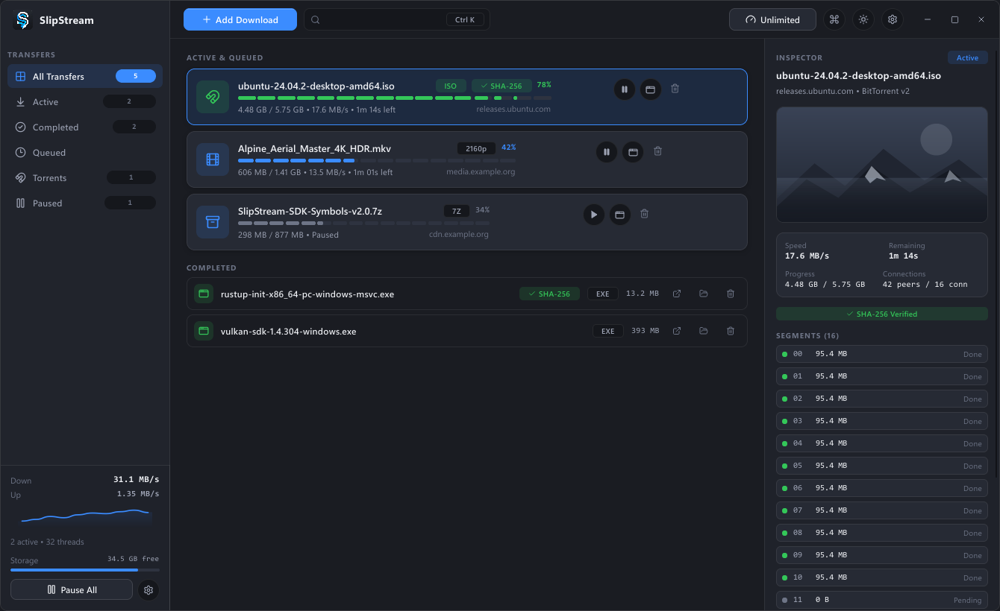
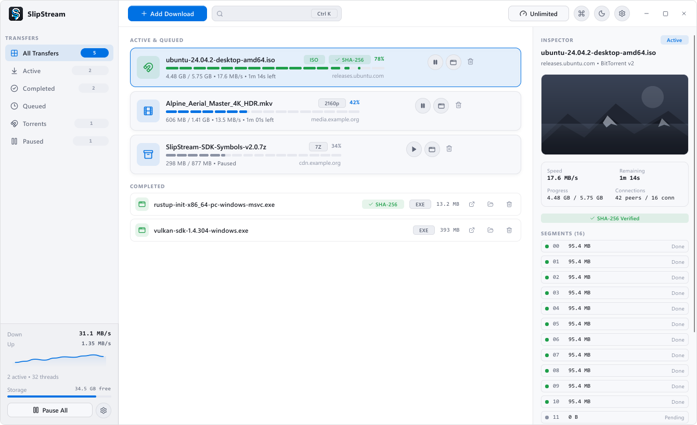

<p align="left">
  
</p>

# SlipStream

**A fast, quiet, security-hardened Windows 10/11 download manager built cleanly with Pure Rust, Slint, and a Manifest V3 browser extension.**

SlipStream combines a multi-segment HTTP download engine, a managed `yt-dlp` + `FFmpeg` media format/audio pipeline, native BitTorrent/Magnet support, and an isolated browser extension inside a dual-theme (**Soft Graphite Dark** ↔ **Porcelain Light**) native desktop workspace.



<details>
<summary>Porcelain Light theme preview</summary>



</details>

---

## About SlipStream

Traditional Windows download managers often expose an unauthenticated localhost HTTP server to intercept browser downloads—allowing arbitrary websites or local scripts to hit control APIs. SlipStream replaces that pattern with **Browser Native Messaging → current-user SID-ACL Windows Named Pipe (`PIPE_REJECT_REMOTE_CLIENTS` + 256-bit `D:P` `session.token`)**, narrowed browser RPC privileges, explicit path/junction confinement, and clean visual restraint.

- **Created by:** Mohamed Sayed
- **Target OS:** Windows 10 / Windows 11 (`x86_64`)
- **Public repository:** [CipherVaults/SlipStream](https://github.com/CipherVaults/SlipStream)
- **Latest release:** [v2.0.0](https://github.com/CipherVaults/SlipStream/releases/tag/v2.0.0)

---

## Features

### 1. Segmented HTTP/1.1 & HTTP/2 Engine (`crates/engine`)
- **Dynamic 1–32 Connections, Adaptive Backdown & Mid-Flight Splitting:** Probes Range support (`HEAD` / `GET bytes=0-0`), reuses open single-use `GET` responses without double-spending tokens, automatically backs down parallel connections on per-IP `503`/`429`/`403` rate limits, falls back across IPv4/header profiles on `403`, and splits active segments whenever remaining chunks exceed `512 KiB`.
- **Crash-Safe SQLite WAL Resume:** Persists segment cursors, `If-Range`, strong `ETag`, and `Last-Modified` validators in SQLite WAL, with atomic `.slipstream-part` → final file commit via `MoveFileExW` and transparent single-stream compression (`gzip`/`deflate`/`brotli`) support.
- **Expired URL Recovery (`Refresh Download Address`):** Swap an expired signed URL (`403` / `410`) in-place via context menu or Transfer Details while keeping already-downloaded bytes intact.
- **Wildcard Batch Expansion & Queues:** Expand padded/unpadded/stepped numeric or alphabetic wildcard patterns up to `10,000` URLs with queue concurrency caps and token-bucket global/per-transfer speed limits.
- **Built-In Integrity & SSRF Hardening:** SHA-256 / MD5 verification, `CheckedDns` IP filtering across up to `10` redirect hops, cross-origin `Cookie` / `Authorization` stripping on redirects, credential scrubbing on HTTP cancel, and Windows NTFS `:Zone.Identifier` (`ZoneId=3`) Mark-of-the-Web preservation.

### 2. Hardened Media & Format Pipeline (`crates/media`)
- **Bundled tools** The installer and portable ZIP include yt-dlp 2026.10.26 and the FFmpeg 9.1 Essentials builds of `ffmpeg.exe` and `ffprobe.exe`, with license files in `bin/`. **Settings → Toolchain → Update yt-dlp** resolves a single upstream release, checks the executable against that release’s SHA-256 checksum, and installs it in your per-user tool directory. Settings shows the active versions and sources of all three tools and supports custom paths.
- **Zero Shell Interpolation:** Invokes `yt-dlp.exe`, `ffmpeg.exe`, and `ffprobe.exe` strictly with discrete argument arrays, allowlisted flags, `--`, forced local FFmpeg demuxers, `YTDLP_NO_PLUGINS=1`, and junction-free canonical `.exe` checks.
- **Format, Container & Audio Selection:** Structured `4K 2160p60` / codec (`AV1`, `VP9`, `H.264`) / container (`MP4`, `MKV`, `WebM`) selection, lossless stream remuxing, audio extraction (`MP3 320k`, `M4A`, `Opus`, `FLAC`, `WAV`) with optional EBU R128 loudness normalization, and subtitle language embedding (`.srt`, `.vtt`, `.ass`, `.ssa`).
- **Selective playlists.** Use the searchable checklist or enter item ranges in **Add Download** to choose videos and preview the destination. SlipStream downloads the selection in order into a dedicated playlist subfolder. Use the collapsible group in **Transfers** to track progress, pause or resume the playlist, or open its folder.
- **Isolated Staging & MotW:** Downloads to scoped UUID staging directories, tags outputs with `:Zone.Identifier`, and publishes atomically via non-overwriting `fs::hard_link`.

### 3. Native BitTorrent & Magnet (`crates/torrent`)
- **Embedded Rust Engine (`librqbit`):** Supports `.torrent` files, raw torrent bytes, and `magnet:` URIs without external torrent daemons.
- **Manifest & Confinement Guards:** Depth-64 bencode decoder with duplicate-key and symlink (`attr 'l'` / `symlink path`) rejection, Windows reserved DOS device and BiDi control filtering, `ConfinedTorrentStorage`, selective file priorities, 16-segment piece-bitmap projection, and NTFS `:Zone.Identifier` tagging on completed files.

### 4. Browser Integration (`crates/native-host` + `extensions/browser`)
- **Cross-Browser MV3:** Supports **Chrome**, **Edge**, **Brave**, and **Firefox** (`slipstream@ciphervaults.com`) using `4`-byte little-endian `1 MiB` Native Messaging framing and per-user `HKCU` registration.
- **One-click Browser Picker** Choose **Add Extension** or **Open Setup** for your browser in **Settings → Browser Integration**. SlipStream opens the browser’s extension setup page and reveals the bundled extension folder. Chrome, Edge, and Brave share the fixed ID `nikdbkenglojniombimjdkneanmponcp`.
- **Floating media pill.** Open the closed Shadow DOM pill for direct HTTP video downloads (`HTTP 200`/`206`), HLS master variants, probed `yt-dlp` qualities, audio presets, or **Download Playlist…** across embedded players and third-party CDNs. Drag the pill to snap it to a player edge, dismiss it in one click, or enable it in fullscreen from the extension popup. Capture-phase protection helps keep page click handlers from interfering with the pill.
- **Privacy & Context Isolation:** Uses Chromium `downloads.onDeterminingFilename` (plus `downloads.onCreated` fallback) with `Alt`-key bypass, broadened extension and inferred-MIME matching, non-private `"cookies"` retrieval, `Alt`-key bypass protection, muted/excluded sites, and **Incognito / Firefox private `cookieStoreId` isolation**. Browser `GetStatus` responses redact desktop query tokens and filesystem paths before leaving the daemon.

### 5. Dual-Theme Windows Desktop App, Floating Dialogs & Auto-Updater (`apps/desktop`)
- **Standalone Floating Download Windows:** Even when the main window is hibernated to the system tray, intercepted HTTP downloads and transfer controls can open dedicated lightweight windows outside the main workspace (each independently toggleable in **Settings → Floating Download Windows**):
  - **Duplicate Download Link:** Prompts with three choices—auto-numbered filename, overwrite existing file cleanly via atomic replacement, or resume/show existing completion dialog.
  - **Download File Info:** Auto-matches the file extension to pre-seeded IDM-style category subfolders (`General`, `Programs`, `Compressed`, `Video`, `Music`, `Documents`, plus `+` custom categories), offers **Save As** with a native Win32 folder picker (`Browse`), optional **Remember this path**, file size, **Description**, **Download Later**, and **Start Download**.
  - **Download Progress:** Shows live `{pct}% {filename}` titlebar updates, speed/ETA/resume stats, `host · protocol · connect_rtt_ms` server info, an expandable `Show details >>` connection map (`N. | Downloaded | Info`), a **Speed Limiter** tab, and **Options on completion**.
  - **Download Complete:** Displays filename, size, SHA-256 verification status, and **Open**, **Open with**, **Open folder**, or **Close** actions.
- **Soft Graphite Dark ↔ Porcelain Light:** Live instant theme switching (plus `Follow System` and `Blue` / `Monochrome` accents), 16-segment progress visualizer, `T01–T16` active thread map, throughput sparkline, and `Ctrl+K` / `Ctrl+N` command shortcuts.
- **Tray-Hibernate Mode & OS Security:** Closes cleanly to the Windows system tray while active downloads continue at minimal RAM with zero WebView processes, reveals completed files via `explorer.exe /select`, and optionally queues Windows Defender (`MpCmdRun.exe`) scans.
- **Signed NSIS updates** In **Settings → About & Updates**, choose **Automatic on startup** or **Manual only**. An automatic check runs once per app process, including across tray restores. **Check for Updates** is available in either mode. **Install Update & Restart** shows live progress for the signed update. If installation is interrupted after downloads are stopped, quit and reopen SlipStream to resume them.
- **Pure Native Controls:** Built directly on Slint (`winit`, `femtovg` + software fallback) with Win32 DWM rounded corners and zero embedded browser processes. **Ctrl+F** / search box filters transfers, **Ctrl+K** opens the Command Palette, and **Ctrl+N** opens **Add Download**.

---

## Security & Verification

- **v2.0.0 Pure Rust + Slint Audit & Verification:** Replaced Tauri v2, WebView2 (`msedgewebview2.exe`), and Node/React desktop dependencies with a single native Slint binary (`0` child WebView2 processes). Remediated all 19 findings from the cross-model Codex CLI (`gpt-6.2-sol`) audit across Win32 clipboard bounds/COM pickers/Open-with, origin-scoped seeded headers, overlay state handling, and signed update staging (`FILE_SHARE_READ` lock + CI `slipstream-sign --verify` gate), verified with **209 / 209** passing Rust workspace tests and **69 / 69** browser extension tests.
- **v1.2.1 Security Audit & DevSecOps Review (`run-2`, `/security-audit` + `/security-auditor`):** Audited `23` coverage units (`15` `candidate`, `7` `covered`, `1` `out_of_scope`) across Rust engines, MV3 extension, React UI, and GitHub Actions with cross-model Codex CLI + Neon verification (`0` confirmed vulnerabilities under read-only/offline policy; `3` prior `v1.0.0` leads verified mitigated in `v1.2.0`). `v1.2.1` landed defense-in-depth hardening across `48+` files—including Completed/legacy SQLite credential scrubbing, strict cross-origin redirect header allowlists + origin-only `Referer` trimming, media userinfo rejection + proxy env cleanup, BitTorrent public-tracker filtering, Win32 Job Objects for `ffmpeg` grandchildren, `GrabBatchUrls` & probe concurrency bounds, WebView CSP/referrer hardening, floating pill live-format & incognito fixes, collision-safe playlist folders/filenames, SHA-pinned CI/Release actions, and lockfile-pinned `@tauri-apps/cli`.
- **v1.0.0 Baseline (`run-1` & `tests/safety-eval`):** [v1.0.0 changelog entry](CHANGELOG.md#100---2026-11-21) — `3` hunting waves across `19` coverage units (`0` confirmed vulnerabilities) plus the preregistered `slipstream-safety-v1` deterministic oracle suite passing **1,200 / 1,200** single-input boundary cases and **108 / 108** orthogonal 5-factor stateful HTTP chaos chains (`0` broken items, `0` escapes, `0` benign false rejections, `bias-audit` Cramér's `V = 0.0`).

---

## Download, Installation & Browser Setup

1. **Installer** Download `SlipStream_2.0.0_x64-setup.exe` and run the per-user installer. It includes the native messaging host, media tools, and both browser extension builds. [v2.0.0 release assets](https://github.com/CipherVaults/SlipStream/releases/tag/v2.0.0)
2. **Portable ZIP** Extract `SlipStream-2.0.0-windows-x64-portable.zip` and run `SlipStream.exe`. Keep the extracted `bin/` and `extensions/` directories beside it.
3. **Browser extension** In **Settings → Browser Integration**, select your browser. For Chrome, Edge, or Brave, enable **Developer mode**, select **Load unpacked**, and choose the revealed folder. In Firefox, choose **Load Temporary Add-on** and select the revealed `manifest.json`. Separate browser extension ZIPs are also available on the release page.

**Upgrading from v1.x** SlipStream keeps the valid native messaging IDs already registered for each browser and adds the bundled extension ID. If an older unpacked copy’s ID is missing from the registration, copy the ID from the browser’s extensions page and enter it in **Settings → Browser Integration** for that browser.

### Building from Source (Windows 10/11)

Prerequisites: **Rust (stable)**, **Node.js 22**, **pnpm 9+**, **VS Build Tools (C++ x64)** (and optionally **NSIS 3** for installer packaging).

```powershell
pnpm.cmd install --frozen-lockfile
if ($LASTEXITCODE -ne 0) { throw 'Workspace dependency installation failed.' }
pnpm.cmd -r typecheck
if ($LASTEXITCODE -ne 0) { throw 'Type checking failed.' }
pnpm.cmd -r test
if ($LASTEXITCODE -ne 0) { throw 'Frontend tests failed.' }
pnpm.cmd -r build
if ($LASTEXITCODE -ne 0) { throw 'Frontend build failed.' }
cargo fetch --locked --target x86_64-pc-windows-msvc
if ($LASTEXITCODE -ne 0) { throw 'Rust dependency fetch failed.' }
$env:CARGO_NET_OFFLINE = 'true'
cargo fmt --all -- --check
if ($LASTEXITCODE -ne 0) { throw 'Rust formatting check failed.' }
cargo clippy --locked --workspace --all-targets -- -D warnings
if ($LASTEXITCODE -ne 0) { throw 'Clippy failed.' }
cargo test --locked --workspace
if ($LASTEXITCODE -ne 0) { throw 'Rust tests failed.' }
cargo build --locked --release -p slipstream-desktop --bin slipstream-desktop
```

The release workflow smoke-tests pinned media tools in a job with no secrets. The signing job verifies fresh downloads against the same pinned SHA-256 digests and packages the tools, notices, and extensions. The release includes the yt-dlp source tarball alongside the installer and ZIPs. [Release workflow](.github/workflows/release.yml), [third-party notices](THIRD_PARTY_NOTICES.md)

---

## Roadmap

- **HTTP/3 (QUIC) Transport:** Upgrade HTTP engine beyond HTTP/1.1 & HTTP/2 with `reqwest` HTTP/3 support when stabilized.
- **OS Power Actions:** Connect OS `PostQueueAction::{Sleep, Shutdown}` execution in the daemon.
- **Toolchain integrity and Authenticode:** Show tool hashes in Settings and add trusted Windows code-signing for installers.
- **Browser store listings:** Publish the extension to Chrome Web Store, Edge Add-ons, and Firefox Add-ons.

---

## Credits

SlipStream is created, designed, and maintained by **Mohamed Sayed**.

---

## Repository Layout

```text
SlipStream/
├── .github/workflows/     # Windows CI + tag-driven signed NSIS/ZIP Release workflows
├── apps/desktop/          # Pure Rust + Slint native desktop app, NSIS installer & Minisign signer
├── crates/
│   ├── protocol/          # Shared IPC schemas + strict path/URL/SSRF security primitives
│   ├── engine/            # Dynamic segmented HTTP downloader, SQLite WAL, scheduler, MotW
│   ├── media/             # Hardened yt-dlp + FFmpeg resolver, format picker, muxer
│   ├── torrent/           # Native Rust BitTorrent / Magnet engine (librqbit)
│   └── native-host/       # Browser Native Messaging host + SID-ACL Named Pipe bridge
├── extensions/browser/    # MV3 Chrome / Edge / Brave / Firefox extension
├── packages/ipc-types/    # Shared TypeScript protocol mirrors
├── docs/                  # Architecture & Design System specs
└── tests/safety-eval/     # Part II safety & resilience evaluation harness
```

## License

Copyright (c) 2026 **Mohamed Sayed**. SlipStream is released under the [MIT License](LICENSE). Bundled components have separate licenses documented in [THIRD_PARTY_NOTICES.md](THIRD_PARTY_NOTICES.md).
